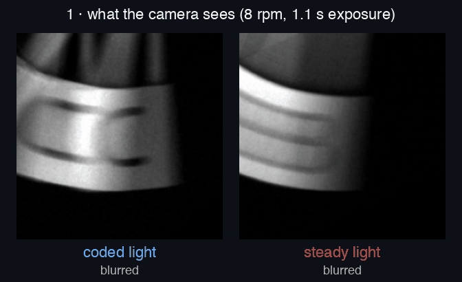
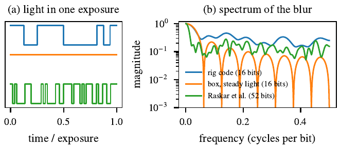
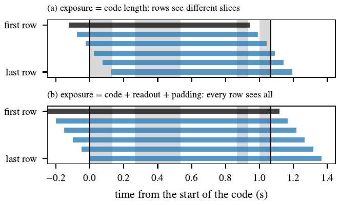
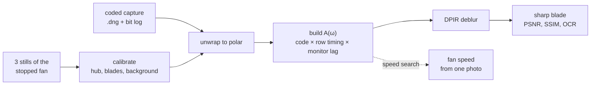
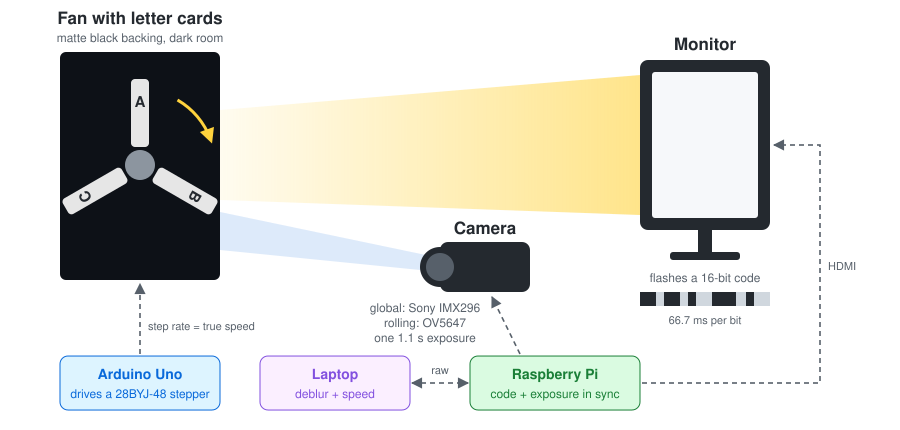
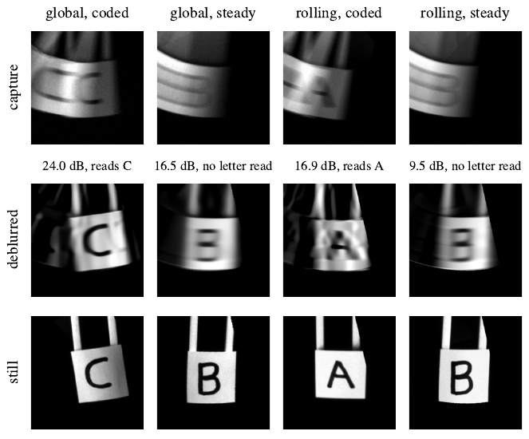
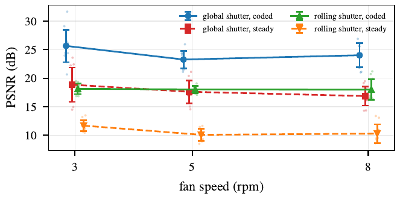
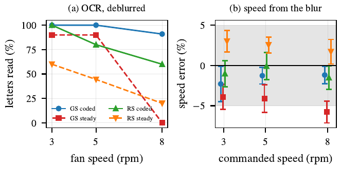
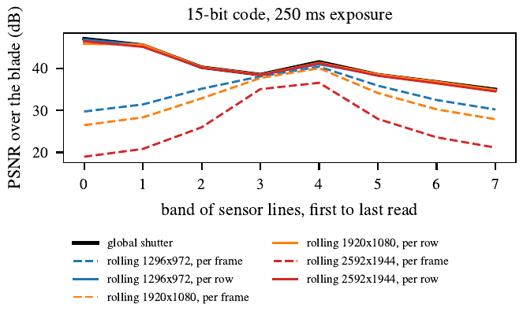
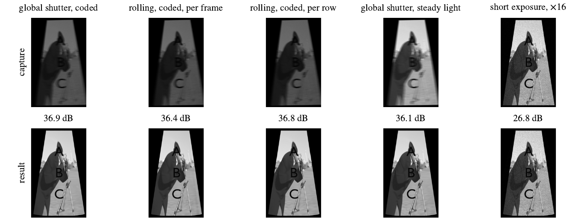

<div align="center">

# Flutter Shutter by Coded Illumination

**Reversible motion blur with an ordinary camera and a computer monitor.**
<br>Global shutter vs rolling shutter, per-frame vs per-row deconvolution.


-EE4C2C?logo=pytorch&logoColor=white)




<sub>Real captures from our rig, fan at 8 rpm, global shutter camera. Same exposure, same deblurring.
Only the light differs: <b>coded</b> flashes come back sharp, <b>steady</b> light does not.</sub>

[How it works](#how-it-works) ·
[The rig](#the-rig) ·
[Results](#results) ·
[Quick start](#quick-start) ·
[Software](#software) ·
[Team](#team)

</div>

---

## Why

Photographing anything that moves forces a trade-off. A long exposure collects enough light but
smears the subject; a short one freezes it but is dark and noisy.

A **flutter shutter** camera escapes this by opening and closing its shutter in a designed binary
code during one long exposure. The blur that results keeps every spatial frequency, so it can be
inverted ([Raskar et al., 2006](#references)). Most cameras cannot flutter their shutter, so we
**flutter the light instead**: a monitor next to the camera flashes the code while the camera holds
one long exposure. The camera is unmodified.

Our test subject is a fan with letters on its blades, driven by a stepper motor at a known speed.
The question we answer is how the camera's shutter interacts with the code, comparing three
methods:

| Method | Sensor | Deconvolution |
| --- | --- | --- |
| **Global shutter** | Sony IMX296, every row exposed at once | one blur for the whole frame |
| **Rolling shutter, per frame** | OV5647, rows exposed one after another | one blur for the whole frame (ignores the stagger) |
| **Rolling shutter, per row** | OV5647 | each row's own slice of the code |

We also estimate the fan's **speed from a single photograph**.

## How it works

<table>
<tr>
<td width="50%"></td>
<td width="50%"></td>
</tr>
<tr>
<td><b>Why code the light.</b> Steady light turns motion into a box blur whose spectrum has exact
zeros (orange): that detail is gone for good. A good code (blue, our 16-bit rig code) keeps every
frequency above zero, so the blur can be undone.</td>
<td><b>Rolling shutter.</b> (a) If the exposure equals the code, each row sees a different slice of
it, so one blur for the whole frame is wrong. (b) Our capture software pads the exposure by the
readout time so every row sees the whole code.</td>
</tr>
</table>

1. **Unwrap.** The image is resampled to polar coordinates about the fan hub, so rotation becomes a
   shift along θ.
2. **Model.** For each ring of radius *r*, the capture is
   **b**<sub>r</sub> = **A**<sub>r</sub>(ω) **x**<sub>r</sub> + **n**, where **A** is a sparse
   matrix built from the code, the exposure window of each sensor row and the measured monitor lag
   (44 ms to brighten, dims at once).
3. **Invert.** [DPIR](#references) (half-quadratic splitting with a pretrained DRUNet denoiser as
   the prior, via `deepinv`) solves for the sharp image **x**. No tuning: the noise level is
   estimated from the capture. Tikhonov least squares is kept as a fast baseline.
4. **Speed.** A wrong speed predicts the wrong blur. We search candidate speeds within ±25% of the
   commanded one and keep the speed whose blur best matches the capture.
5. **Calibrate.** Three stills of the stopped fan, 400 motor steps apart, give the hub centre and
   blade geometry automatically. Their pixel-wise minimum (mount, bolts, wires) is subtracted so
   only the blades are deblurred.



## The rig

<p align="center"></p>

| Part | What it does |
| --- | --- |
| **Monitor** on the Raspberry Pi | flashes black/white, one code bit per four 60 Hz refreshes (66.7 ms) |
| **Global shutter camera**, Sony IMX296, 1456×1088 | readout 16.6 ms |
| **Rolling shutter camera**, OV5647, 2592×1944 | readout 64.0 ms, exposure padded by 0.25 s |
| **Fan** on a 28BYJ-48 stepper (2038 full steps/rev) via ULN2003 + Arduino Uno | 3, 5 and 8 rpm; the step rate is the ground-truth speed |
| **Letter cards** taped to each blade, matte black backing, dark room | the thing we try to read |
| **Capture software** (Pi + laptop) | one button starts the exposure and the code together, saves the raw `.dng` and a log of when each bit was shown |

## Results

<p align="center"></p>
<p align="center"><sub>The letter card at 8 rpm, median capture of each camera and light. Top: one 1.1 to 1.4 s
exposure. Middle: our reconstruction. Bottom: a still of the stopped fan. Coded light brings the letter
back on both cameras; steady light of the same length does not.</sub></p>

### Against our success criteria

| Criterion | Target | Rig (real captures) | Simulation |
| --- | --- | --- | --- |
| **1. Per-row vs global**, image quality by band of rows | per row within 1 dB of global shutter | not testable: padding makes every row see the whole code, so per row and per frame coincide | per row within **0.3 dB** of global on average (worst band 1.2 dB); per frame drops up to 14 dB |
| **2. Legibility**, letters read by OCR | ≥ 90% coded where steady < 50% | ✅ global, 8 rpm: **91%** coded vs **0%** steady<br/>rolling, 8 rpm: 60% vs 20% | |
| **3. Blind speed**, from one photo | within 5% | ✅ **34 / 35** global and **30 / 30** rolling coded captures within 5% | within **0.2%** |
| **Code timing**, does the monitor show the code on time | | **298 / 304** flashes within 1 ms of schedule | |

On the rig, coded light deblurs **5.6 to 7.1 dB** better than steady light on the global shutter and
**6.4 to 8.0 dB** better on the rolling shutter, at every speed (65 and 59 captures).

<table>
<tr>
<td width="50%"></td>
<td width="50%"></td>
</tr>
<tr>
<td><b>Image quality on the rig.</b> Deblurred blade against the stopped fan, mean ± std over 9 to 12
captures per point.</td>
<td><b>Criteria 2 and 3 on the rig.</b> (a) Letters read after deblurring. (b) Speed from the blur;
grey band is the ±5% target.</td>
</tr>
<tr>
<td></td>
<td></td>
</tr>
<tr>
<td><b>Criterion 1 in simulation</b>, unpadded exposure. Per row (solid) tracks the global shutter
(black); per frame (dashed) degrades away from the rows its timing was right for.</td>
<td><b>Simulation</b> (Blender): a textured blade deblurred to 38.4 dB against the stopped fan.</td>
</tr>
</table>

### What didn't work, and what we learned

- **A hand-spun CD** was our first target. Its speed changed during each exposure, so no single blur
  explained the image. Hence the stepper motor.
- **The monitor is slow to brighten** (44 ms rise), so a one-bit flash gives about half its designed
  light. Modelling the lag improved 40 of 46 global shutter captures by 0.3 to 0.8 dB.
- **The background must be dark.** Anything bright behind the blades is hidden and uncovered as they
  pass, which the model does not include.
- **The three blades look alike.** Matching the deblurred blade alone picked the wrong card 13 of 35
  times; matching the whole capture picked the right one every time.
- **Padding the rolling shutter** makes it work, but means the rig cannot show per-frame failing;
  that comparison is simulation only.

With more time: an LED instead of a monitor (microsecond switching, codes hundreds of bits long),
codes designed for the rolling shutter, and everyday scenes where motion must be estimated per object.

## Quick start

**In the lab**

1. Plug the Pi into the laptop (ethernet, or both on a phone hotspot).
2. Open this folder in VS Code. Run Task > **1. Lab: set up everything and connect a camera**.
   (Or double-click `start-mac.command` / `start-windows.bat`.)
3. Wait for **READY**. Type `g` (global shutter) or `r` (rolling shutter). Pi password: `mech5720`.
4. The camera window opens. Photos save to `output/`.

First time on a laptop it downloads about 1 GB (3 minutes, needs internet). After that, seconds.

**Deblur a capture folder**

```bash
cd software/deconvolution
uv sync
uv run python deblur.py gs_3rpm      # calibrates from gs_stills, deblurs and scores every capture
```

Results land in `out/gs_3rpm/`. The full lab protocol (fan commands, which shots to take, and what
every warning means) is in [`software/deconvolution/README.md`](software/deconvolution/README.md).

**Run the tests**

```bash
cd software/deconvolution && uv run pytest
```

## Software

```
.
├── start-mac.command, start-windows.bat   one-click lab setup
├── software/
│   ├── data_capture/     camera server (Pi) and camera window (laptop), coded capture
│   ├── illumination/     flash display on the Pi
│   ├── coded_sequence/   code design and noise analysis
│   ├── motor_control/    fan Arduino sketch
│   ├── deconvolution/    calibration, deblurring (3 methods), speed estimate, tests, simulation
│   └── view_raw.py       view captured DNGs
└── presentation/         lightning talk slides
```

| Folder | Read more |
| --- | --- |
| `software/data_capture` | [setup, Pi, capturing](software/data_capture/README.md) |
| `software/deconvolution` | [lab day and commands](software/deconvolution/README.md) · [simulation studies and results](software/deconvolution/STUDIES.md) |
| `software/illumination` | [running the display](software/illumination/README.md) |

## Team

| | Role |
| --- | --- |
| **Jack Thompson** | coded sequence design and deblurring pipeline |
| **Oliver Turner** | camera control and calibration in setup |
| **Krish Singh** | deconvolution and velocity estimation pipeline |
| **Daniel Chung** | monitor animation, velocity estimation algorithm |
| **Ben Ritchie** | test rig design and implementation |

MECH5720 Robotic Imaging, The University of Sydney, 2026.

<details>
<summary><b>Original project proposal</b> (goal, success criteria, fallback)</summary>

### Goal
Our system will compare three methods for flutter shutter photography with coded illumination: rolling shutter
deconvolved on a per-frame basis, rolling shutter deconvolved per-row and global shutter deconvolved per-frame.
Flutter shutter cameras break the light/motion blur trade-off that conventional cameras face when imaging moving
objects. Global shutter cameras overcome the artefacts rolling shutters exhibit from their row-by-row capture. The
rolling shutter artefacts can also be accounted for by applying the deconvolution on a row-by-row basis.
The recovered sharp images from flutter shutter cameras are useful for high speed applications. This project will
emulate the flutter shutter method with coded illumination to image fast-moving subjects and compare the performance
of the three different methods mentioned above.

### Approach
A fan with characters on the blades will be spinning at a controllable rate and imaged by a coded illumination rig
including a monitor and a camera. Within one exposure on the camera, the monitor will flash in a coded binary
sequence, producing a known blurring effect in the recorded image. Both a global shutter and a rolling shutter camera
will be used to image the subject and the images will be put through a processing pipeline which de-convolves the
image using the known shutter sequence to undo the motion blur and estimate a velocity for each of the 3 methods
discussed above. The results can then be compared.

### Success criteria
All metrics are reported as mean ± std over ≥10 repeated captures per speed; ground-truth speed from the motor
step rate. Three-way comparison:
1. For each proposed method, we plot image quality against a photo of the stationary fan (PSNR/SSIM) for each
band of rows from top to bottom of the image. Target: per-row rolling shutter within 1 dB of global shutter across
all rows, while per-frame rolling shutter degrades away from the rows its code was timed for.
2. Fan legibility vs. speed: fraction of fan blade characters read correctly by OCR for coded light then deblurred,
constant light then deblurred, and a very short exposure with brightness boosted. Target: ≥90% read correctly
with coded light at speeds where constant light gives less than 50%.
3. Blind speed estimate: rotation speed estimated from the length of the blur arc, plotted against the true speed.
Target: within 5%.

Does the system behave as designed? We photograph a bright dot on a moving blade to see the blur pattern directly,
and check that it matches our flashing sequence and keeps the fine detail that constant light loses.

### Fallback
If a global shutter camera cannot be sourced and mounted by Week 10, we run the pipeline on the kit rolling shutter
camera alone and compare coded against constant monitor illumination. If per-row deconvolution fails, we deconvolve
each rolling shutter frame with a single kernel, keeping the full code inside the window where all rows are exposing. If
the stepper rig cannot hold a constant speed, we switch to a slow fan target with its speed measured independently
by high-frame-rate video. If blind speed estimation fails, we deblur using the commanded stepper speed and report
PSNR/SSIM against blur length. At minimum, we show that the measured kernel of a point target on the rig matches
the designed code and has no spectral nulls, unlike the box kernel.

### Hardware
A coded illumination rig using a monitor displaying black/white screens in a designed binary sequence
while the global shutter camera and rolling shutter camera hold one continuous exposure, so the target's motion is
convolved with a broadband code instead of a simple box blur. This will be tested primarily with a spinning fan
controlled via a stepper motor, so that the speed can be controlled and recorded.

</details>

## References

- R. Raskar, A. Agrawal, J. Tumblin. *Coded Exposure Photography: Motion Deblurring Using Fluttered Shutter.* ACM Transactions on Graphics 25(3), 2006.
- K. Zhang, Y. Li, W. Zuo, L. Zhang, L. Van Gool, R. Timofte. *Plug-and-Play Image Restoration With Deep Denoiser Prior.* IEEE TPAMI 44(10), 2022.
- A. Agrawal, Y. Xu. *Coded Exposure Deblurring: Optimized Codes for PSF Estimation and Invertibility.* CVPR 2009.
- J. Gu, Y. Hitomi, T. Mitsunaga, S. Nayar. *Coded Rolling Shutter Photography: Flexible Space-Time Sampling.* ICCP 2010.
- C.-K. Liang, L.-W. Chang, H. H. Chen. *Analysis and Compensation of Rolling Shutter Effect.* IEEE TIP 17(8), 2008.
